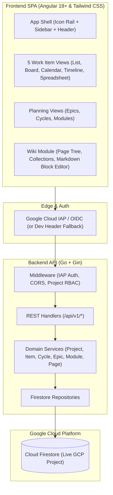
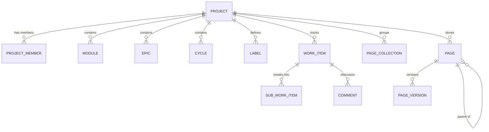

# Jynko: Open-Source Project Management System Architecture Specification

## 1. System Context and Architectural Overview

This document specifies the technical architecture for **Jynko**, an open-source, high-performance project management and knowledge platform hosted on GitHub. Designed to maximize developer productivity and team collaboration, the system provides work tracking across projects, feature modules, epics, cycles, work items, sub-work items, labels, and threaded discussion comments, seamlessly integrated with a dedicated **Wiki and Knowledge Management System**.

The platform is architected as a decoupled system featuring a **Go REST API backend** powered by the **Gin framework**, **Google Cloud Firestore** (direct connection to a live GCP Firestore project) as the primary NoSQL document database, and an **Angular 18+ single-page application** styled natively with **Tailwind CSS** in a light-theme design system. Authentication is handled via **Google Cloud Identity-Aware Proxy (IAP) / OIDC headers** (with a configurable local fallback for `ENV=development`). A per-project **Role-Based Access Control (RBAC)** model enforces authorization across all resources (`Project` is the top-level tenant; there is no Workspace entity).

### Architectural Component Layers

* **Frontend Layer (Angular 18+ & Tailwind CSS)**: Single-page application rendering high-density business interfaces in a clean light-mode canvas (`slate-50`), including 5 work item views (**List**, **Board / Kanban**, **Calendar**, **Timeline / Gantt**, and **Spreadsheet**), detail drawers, Epics roadmaps, Cycle sprint planners, Feature Modules, a Markdown-based block Wiki editor with slash commands (`/`) and rich preview, and hierarchical page trees.
* **API Gateway & Middleware Layer (Go & Gin Framework)**: High-throughput HTTP server executing Google Cloud IAP / OIDC header verification, per-project RBAC authorization checks, CORS handling, and request validation.
* **Service & Domain Layer (Go)**: Business logic components managing project lifecycles, atomic work item sequence numbering (`JYNKO-1`), sprint cycle planning, epic roadmaps, module grouping, label management, comment processing, and wiki document versioning.
* **Wiki & Knowledge Engine (Go)**: Document management subsystem handling nested page trees, page collections, Markdown block storage, version history snapshots, and page locking governed by project RBAC.
* **Database & Storage Layer (GCP Firestore)**: Live Google Cloud Firestore document database storing projects (top-level tenant), project members, work items, sub-items, cycles, epics, modules, labels, comments, wiki pages, page versions, and page collections.



---

## 2. Repository Layout and Package Structure

To enable clean modularity and predictable code generation, the Jynko codebase follows standard Go project layouts and modular standalone Angular package structures.

### Backend Directory Layout (`/backend`)

```text
backend/
├── cmd/
│   └── server/
│       └── main.go                      # Entrypoint for Gin HTTP server
├── internal/
│   ├── config/
│   │   └── config.go                    # Environment configuration loader (GCP Project, Dev Auth)
│   ├── handler/
│   │   ├── auth_handler.go              # Handler for /api/v1/auth/me (IAP identity inspection)
│   │   ├── comment_handler.go           # Handlers for Work Item comments
│   │   ├── cycle_handler.go             # Handlers for Cycles management
│   │   ├── epic_handler.go              # Handlers for Epics management
│   │   ├── item_handler.go              # Handlers for Work Items & Sub-items
│   │   ├── label_handler.go             # Handlers for project Labels
│   │   ├── module_handler.go            # Handlers for Modules management
│   │   ├── page_handler.go              # Handlers for Wiki Pages, Versions & Collections
│   │   └── project_handler.go           # Handlers for Projects and RBAC member assignments
│   ├── middleware/
│   │   ├── auth.go                      # Google Cloud IAP / OIDC header validator (+ dev fallback)
│   │   ├── cors.go                      # Cross-Origin Resource Sharing middleware
│   │   └── rbac.go                      # Per-project RBAC enforcement middleware
│   ├── model/
│   │   ├── domain.go                    # Domain structs (Project, Epic, Module, Cycle, Label, WorkItem, SubWorkItem, Comment)
│   │   ├── page.go                      # Struct definitions for Wiki Pages, Versions & Collections
│   │   └── rbac.go                      # Role, permission, and UserContext definitions
│   ├── repository/
│   │   ├── firestore_client.go          # Firestore initialization & transaction helpers
│   │   ├── cycle_repository.go          # Firestore CRUD operations for Cycles
│   │   ├── epic_repository.go           # Firestore CRUD operations for Epics
│   │   ├── item_repository.go           # Firestore CRUD operations for Work Items, Sub-items & Comments
│   │   ├── label_repository.go          # Firestore CRUD operations for Labels
│   │   ├── module_repository.go         # Firestore CRUD operations for Modules
│   │   ├── page_repository.go           # Firestore CRUD operations for Wiki Pages, Versions & Collections
│   │   └── project_repository.go        # Firestore CRUD operations for Projects & Members
│   └── service/
│       ├── cycle_service.go             # Business logic for Cycles
│       ├── epic_service.go              # Business logic for Epics
│       ├── item_service.go              # Business logic for Work Items, Sub-items & Comments
│       ├── label_service.go             # Business logic for Labels
│       ├── module_service.go            # Business logic for Modules
│       ├── page_service.go              # Business logic for Wiki Pages, Versions & Collections
│       └── project_service.go           # Business logic for Projects & RBAC
├── .env.example
├── go.mod
├── go.sum
└── Dockerfile
```

### Frontend Directory Layout (`/frontend`)

```text
frontend/
├── src/
│   ├── app/
│   │   ├── core/
│   │   │   ├── guards/
│   │   │   │   └── rbac.guard.ts                    # Angular route guard for project RBAC roles
│   │   │   ├── interceptors/
│   │   │   │   └── auth.interceptor.ts              # HTTP interceptor attaching dev IAP headers in local mode
│   │   │   ├── models/
│   │   │   │   ├── page.model.ts                    # TypeScript interfaces for Wiki Pages & Collections
│   │   │   │   └── project.model.ts                 # TypeScript interfaces for Project, WorkItem, Cycle, Epic, Module, Label
│   │   │   └── services/
│   │   │       ├── api.service.ts                   # Generic HTTP client wrapper
│   │   │       ├── auth.service.ts                  # Current user identity signal store (/api/v1/auth/me)
│   │   │       ├── page.service.ts                  # Reactive Signal state store for Wiki Pages
│   │   │       ├── project.service.ts               # Reactive Signal state store for Projects, Members, Epics, Cycles, Modules, Labels
│   │   │       └── work-item.service.ts             # Reactive Signal state store & filter engine for Work Items
│   │   ├── features/
│   │   │   ├── cycles/                              # Cycle sprint planning components
│   │   │   ├── epics/                               # Epic roadmap components
│   │   │   ├── modules/                             # Feature module view components
│   │   │   ├── projects/                            # Project selector, list, creation, and RBAC settings views
│   │   │   ├── wiki/                                # Wiki & Knowledge Base feature module
│   │   │   │   ├── collection-list/                 # Grouped page collections view
│   │   │   │   ├── page-detail/                     # Main document view & editor container
│   │   │   │   ├── page-editor/                     # Markdown-based block editor with slash commands (/) & preview
│   │   │   │   ├── page-tree/                       # Hierarchical nested page tree navigation
│   │   │   │   └── version-history/                 # Page revision audit trail drawer
│   │   │   └── work-items/                          # Work Items container & 5 views
│   │   │       ├── work-items-shell/                # View switcher toolbar, filter bar & view host
│   │   │       ├── work-item-list/                  # High-density grouped list view
│   │   │       ├── work-item-board/                 # Kanban drag-and-drop board view
│   │   │       ├── work-item-calendar/              # Monthly/weekly due-date & schedule calendar view
│   │   │       ├── work-item-timeline/              # Gantt-style timeline bar view (start_date to due_date)
│   │   │       ├── work-item-spreadsheet/           # Inline-editable data grid spreadsheet view
│   │   │       └── work-item-detail-drawer/         # Slide-over drawer for editing item, sub-items & comments
│   │   ├── shared/
│   │   │   ├── components/                          # Reusable UI components (StatusBadge, PriorityBadge, LabelPill, Avatar, Modal)
│   │   │   └── pipes/                               # Formatting & Markdown pipes
│   │   ├── app.component.ts
│   │   └── app.routes.ts
│   ├── assets/
│   ├── environments/
│   │   ├── environment.ts
│   │   └── environment.development.ts
│   ├── styles.css                                   # Tailwind CSS imports (Slate-50 light theme)
│   └── index.html
├── angular.json
├── package.json
├── tailwind.config.js
└── tsconfig.json
```

---

## 3. Data Models and Firestore Schema

Google Cloud Firestore operates as the primary document database storing data across top-level `projects` and their subcollections. **There is no Workspace entity**—`Project` is the top-level organizational and permission boundary.

### Entity Relationship Mapping

* **Project** (`projects/{projectId}`): Top-level isolation boundary for permissions, resources, sequence counters, and work tracking.
* **Project Member** (`projects/{projectId}/members/{userId}`): Stores per-project RBAC role assignments (`ADMIN`, `MEMBER`, `VIEWER`).
* **Module** (`projects/{projectId}/modules/{moduleId}`): Functional feature domain that remains persistent across the software lifecycle.
* **Epic** (`projects/{projectId}/epics/{epicId}`): Time-bound strategic objective or milestone grouping multiple work items.
* **Cycle** (`projects/{projectId}/cycles/{cycleId}`): Time-boxed iteration or sprint period for scheduled execution.
* **Label** (`projects/{projectId}/labels/{labelId}`): Categorical metadata tag with a hex color attached to work items or wiki pages.
* **Work Item** (`projects/{projectId}/work_items/{itemId}`): Primary actionable unit of work with human-readable key (`JYNKO-1`), status, priority, dates, and estimate.
* **Sub-Work Item** (`projects/{projectId}/work_items/{itemId}/sub_items/{subItemId}`): Granular checklist task belonging to a parent work item.
* **Comment** (`projects/{projectId}/work_items/{itemId}/comments/{commentId}`): Discussion message record attached to a work item.
* **Page Collection** (`projects/{projectId}/collections/{collectionId}`): Categorical grouping container for wiki pages.
* **Page** (`projects/{projectId}/pages/{pageId}`): Structured document page containing Markdown blocks. Supports parent-child nesting (`parent_page_id`) for hierarchical page trees. Visibility and editing follow the parent project's RBAC roles.
* **Page Version** (`projects/{projectId}/pages/{pageId}/versions/{versionId}`): Immutable snapshot of historical document revisions.



### Go Domain Struct Definitions

```go
package model

import "time"

// ProjectRole represents a per-project RBAC role.
type ProjectRole string

const (
	RoleAdmin  ProjectRole = "ADMIN"
	RoleMember ProjectRole = "MEMBER"
	RoleViewer ProjectRole = "VIEWER"
)

// UserContext represents the authenticated user identity extracted from Google Cloud IAP headers.
type UserContext struct {
	UserID string `json:"user_id"`
	Email  string `json:"email"`
	Name   string `json:"name"`
}

// Project represents the top-level boundary for work tracking, documentation, and RBAC.
type Project struct {
	ID          string    `firestore:"id" json:"id"`
	Name        string    `firestore:"name" json:"name"`
	KeyPrefix   string    `firestore:"key_prefix" json:"key_prefix"` // e.g., "JYNKO"
	Description string    `firestore:"description" json:"description"`
	ItemSeq     int       `firestore:"item_seq" json:"item_seq"`     // Atomic sequence counter for WorkItem keys
	MemberIDs   []string  `firestore:"member_ids" json:"member_ids"` // Indexed array of user IDs for fast project listing
	CreatedBy   string    `firestore:"created_by" json:"created_by"`
	CreatedAt   time.Time `firestore:"created_at" json:"created_at"`
	UpdatedAt   time.Time `firestore:"updated_at" json:"updated_at"`
}

// ProjectMember defines a user's role assignment in a project.
type ProjectMember struct {
	UserID   string      `firestore:"user_id" json:"user_id"`
	Email    string      `firestore:"email" json:"email"`
	Name     string      `firestore:"name" json:"name"`
	Role     ProjectRole `firestore:"role" json:"role"`
	JoinedAt time.Time   `firestore:"joined_at" json:"joined_at"`
}

// Module represents a persistent functional component or feature domain.
type Module struct {
	ID          string    `firestore:"id" json:"id"`
	ProjectID   string    `firestore:"project_id" json:"project_id"`
	Name        string    `firestore:"name" json:"name"`
	Description string    `firestore:"description" json:"description"`
	LeadUserID  string    `firestore:"lead_user_id" json:"lead_user_id"`
	CreatedAt   time.Time `firestore:"created_at" json:"created_at"`
	UpdatedAt   time.Time `firestore:"updated_at" json:"updated_at"`
}

// Epic represents a strategic milestone or major initiative.
type Epic struct {
	ID          string     `firestore:"id" json:"id"`
	ProjectID   string     `firestore:"project_id" json:"project_id"`
	Name        string     `firestore:"name" json:"name"`
	Description string     `firestore:"description" json:"description"`
	Status      string     `firestore:"status" json:"status"` // PLANNED, IN_PROGRESS, COMPLETED, CANCELLED
	StartDate   *time.Time `firestore:"start_date,omitempty" json:"start_date,omitempty"`
	TargetDate  *time.Time `firestore:"target_date,omitempty" json:"target_date,omitempty"`
	CreatedAt   time.Time  `firestore:"created_at" json:"created_at"`
	UpdatedAt   time.Time  `firestore:"updated_at" json:"updated_at"`
}

// Cycle represents a sprint period or iteration.
type Cycle struct {
	ID          string    `firestore:"id" json:"id"`
	ProjectID   string    `firestore:"project_id" json:"project_id"`
	Name        string    `firestore:"name" json:"name"`
	Description string    `firestore:"description" json:"description"`
	StartDate   time.Time `firestore:"start_date" json:"start_date"`
	EndDate     time.Time `firestore:"end_date" json:"end_date"`
	IsActive    bool      `firestore:"is_active" json:"is_active"`
	CreatedAt   time.Time `firestore:"created_at" json:"created_at"`
	UpdatedAt   time.Time `firestore:"updated_at" json:"updated_at"`
}

// Label represents a categorical metadata tag within a project.
type Label struct {
	ID        string    `firestore:"id" json:"id"`
	ProjectID string    `firestore:"project_id" json:"project_id"`
	Name      string    `firestore:"name" json:"name"`
	Color     string    `firestore:"color" json:"color"` // Hex color e.g. "#0284c7"
	CreatedAt time.Time `firestore:"created_at" json:"created_at"`
}

// WorkItemStatus & WorkItemPriority constants
const (
	StatusBacklog    = "BACKLOG"
	StatusTodo       = "TODO"
	StatusInProgress = "IN_PROGRESS"
	StatusInReview   = "IN_REVIEW"
	StatusDone       = "DONE"
	StatusCancelled  = "CANCELLED"

	PriorityNone   = "NONE"
	PriorityLow    = "LOW"
	PriorityMedium = "MEDIUM"
	PriorityHigh   = "HIGH"
	PriorityUrgent = "URGENT"
)

// WorkItem represents an actionable task.
type WorkItem struct {
	ID                string     `firestore:"id" json:"id"`
	ProjectID         string     `firestore:"project_id" json:"project_id"`
	Key               string     `firestore:"key" json:"key"`                 // e.g., "JYNKO-12"
	SequenceID        int        `firestore:"sequence_id" json:"sequence_id"` // e.g., 12
	ModuleID          string     `firestore:"module_id,omitempty" json:"module_id,omitempty"`
	EpicID            string     `firestore:"epic_id,omitempty" json:"epic_id,omitempty"`
	CycleID           string     `firestore:"cycle_id,omitempty" json:"cycle_id,omitempty"`
	Title             string     `firestore:"title" json:"title"`
	Description       string     `firestore:"description" json:"description"`
	Status            string     `firestore:"status" json:"status"`     // BACKLOG, TODO, IN_PROGRESS, IN_REVIEW, DONE, CANCELLED
	Priority          string     `firestore:"priority" json:"priority"` // NONE, LOW, MEDIUM, HIGH, URGENT
	AssigneeID        string     `firestore:"assignee_id,omitempty" json:"assignee_id,omitempty"`
	ReporterID        string     `firestore:"reporter_id" json:"reporter_id"`
	LabelIDs          []string   `firestore:"label_ids" json:"label_ids"`
	Estimate          *int       `firestore:"estimate,omitempty" json:"estimate,omitempty"` // Story points / effort estimate
	StartDate         *time.Time `firestore:"start_date,omitempty" json:"start_date,omitempty"`
	DueDate           *time.Time `firestore:"due_date,omitempty" json:"due_date,omitempty"`
	SubItemCount      int        `firestore:"sub_item_count" json:"sub_item_count"`
	CompletedSubCount int        `firestore:"completed_sub_count" json:"completed_sub_count"`
	CreatedAt         time.Time  `firestore:"created_at" json:"created_at"`
	UpdatedAt         time.Time  `firestore:"updated_at" json:"updated_at"`
}

// SubWorkItem represents a child task under a parent WorkItem.
type SubWorkItem struct {
	ID           string    `firestore:"id" json:"id"`
	ParentItemID string    `firestore:"parent_item_id" json:"parent_item_id"`
	Title        string    `firestore:"title" json:"title"`
	IsCompleted  bool      `firestore:"is_completed" json:"is_completed"`
	AssigneeID   string    `firestore:"assignee_id,omitempty" json:"assignee_id,omitempty"`
	CreatedAt    time.Time `firestore:"created_at" json:"created_at"`
	UpdatedAt    time.Time `firestore:"updated_at" json:"updated_at"`
}

// Comment represents a message on a WorkItem.
type Comment struct {
	ID         string    `firestore:"id" json:"id"`
	WorkItemID string    `firestore:"work_item_id" json:"work_item_id"`
	AuthorID   string    `firestore:"author_id" json:"author_id"`
	AuthorName string    `firestore:"author_name" json:"author_name"`
	Body       string    `firestore:"body" json:"body"`
	CreatedAt  time.Time `firestore:"created_at" json:"created_at"`
	UpdatedAt  time.Time `firestore:"updated_at" json:"updated_at"`
}

// PageCollection represents a logical grouping container for wiki pages.
type PageCollection struct {
	ID          string    `firestore:"id" json:"id"`
	ProjectID   string    `firestore:"project_id" json:"project_id"`
	Name        string    `firestore:"name" json:"name"`
	Description string    `firestore:"description" json:"description"`
	CreatedAt   time.Time `firestore:"created_at" json:"created_at"`
	UpdatedAt   time.Time `firestore:"updated_at" json:"updated_at"`
}

// Page represents a documentation document in the Wiki system.
// Visibility and edit permissions follow the parent Project's RBAC roles.
type Page struct {
	ID           string    `firestore:"id" json:"id"`
	ProjectID    string    `firestore:"project_id" json:"project_id"`
	CollectionID string    `firestore:"collection_id,omitempty" json:"collection_id,omitempty"`
	ParentPageID string    `firestore:"parent_page_id,omitempty" json:"parent_page_id,omitempty"` // For nested page tree
	Title        string    `firestore:"title" json:"title"`
	Content      string    `firestore:"content" json:"content"` // Markdown block content
	Order        int       `firestore:"order" json:"order"`     // Sort order within sibling pages
	IsLocked     bool      `firestore:"is_locked" json:"is_locked"`
	LabelIDs     []string  `firestore:"label_ids" json:"label_ids"`
	CreatedBy    string    `firestore:"created_by" json:"created_by"`
	UpdatedBy    string    `firestore:"updated_by" json:"updated_by"`
	CreatedAt    time.Time `firestore:"created_at" json:"created_at"`
	UpdatedAt    time.Time `firestore:"updated_at" json:"updated_at"`
}

// PageVersion represents an immutable historical revision of a Page.
type PageVersion struct {
	ID        string    `firestore:"id" json:"id"`
	PageID    string    `firestore:"page_id" json:"page_id"`
	Title     string    `firestore:"title" json:"title"`
	Content   string    `firestore:"content" json:"content"`
	CreatedBy string    `firestore:"created_by" json:"created_by"`
	CreatedAt time.Time `firestore:"created_at" json:"created_at"`
}
```

---

## 4. Authentication & Role-Based Access Control (RBAC) Security Model

### Google Cloud IAP / OIDC Authentication

Jynko relies on **Google Cloud Identity-Aware Proxy (IAP)** / OIDC headers for user authentication:
* `X-Goog-Authenticated-User-Id`: e.g., `accounts.google.com:1122334455` (normalized to a stable user ID or email-based ID).
* `X-Goog-Authenticated-User-Email`: e.g., `accounts.google.com:user@example.com` (stripped of the provider prefix).
* `X-Goog-IAP-JWT-Assertion`: Optional signed JWT assertion when cryptographic verification is configured (`IAP_AUDIENCE`).
* **Local Development Mode (`ENV=development`)**: When running locally outside GCP, the auth middleware accepts `X-Dev-User-Id`, `X-Dev-User-Email`, and `X-Dev-User-Name` headers or falls back to default developer credentials configured in `.env` (`DEV_USER_ID`, `DEV_USER_EMAIL`, `DEV_USER_NAME`).

Any IAP-authenticated user can create a new `Project` via `POST /api/v1/projects` and is automatically registered as an `ADMIN` in `projects/{projectId}/members/{userId}`.

### Permission Matrix

Authorization is managed at the project level using a three-tier Role-Based Access Control model covering both project management tasks and knowledge base pages:

| Operation / Scope | Admin | Member | Viewer |
| :--- | :---: | :---: | :---: |
| Create a New Project | Allowed (Any Auth User) | Allowed (Any Auth User) | Allowed (Any Auth User) |
| Manage Project Settings, Delete Project & Manage RBAC Roles | Allowed | Denied | Denied |
| Create / Edit / Delete Modules, Epics, Cycles, Labels | Allowed | Allowed | Denied |
| Create / Edit / Delete Work Items & Sub-items | Allowed | Allowed | Denied |
| Add / Edit / Delete Comments & Attach Labels | Allowed | Allowed | Denied |
| Create / Edit Wiki Pages & Collections | Allowed | Allowed | Denied |
| Lock / Unlock / Delete / Restore Wiki Pages | Allowed | Allowed | Denied |
| View Projects, Items, Epics, Cycles, Modules, Wiki Pages | Allowed | Allowed | Allowed |

### Gin RBAC Middleware Implementation

```go
package middleware

import (
	"net/http"

	"github.com/gin-gonic/gin"
	"jynko/internal/model"
	"jynko/internal/repository"
)

// RequireProjectRole checks if the authenticated user has the required minimum role in the target project.
func RequireProjectRole(projectRepo repository.ProjectRepository, minRole model.ProjectRole) gin.HandlerFunc {
	return func(c *gin.Context) {
		userCtx, exists := GetUserContext(c)
		if !exists || userCtx.UserID == "" {
			c.AbortWithStatusJSON(http.StatusUnauthorized, gin.H{"error": "unauthorized"})
			return
		}

		projectID := c.Param("projectId")
		if projectID == "" {
			c.AbortWithStatusJSON(http.StatusBadRequest, gin.H{"error": "missing projectId parameter"})
			return
		}

		member, err := projectRepo.GetMember(c.Request.Context(), projectID, userCtx.UserID)
		if err != nil || member == nil {
			// Fallback check by email if user was invited by email before their first login
			member, err = projectRepo.GetMemberByEmail(c.Request.Context(), projectID, userCtx.Email)
			if err != nil || member == nil {
				c.AbortWithStatusJSON(http.StatusForbidden, gin.H{"error": "access denied: not a project member"})
				return
			}
		}

		if !HasPermission(member.Role, minRole) {
			c.AbortWithStatusJSON(http.StatusForbidden, gin.H{"error": "insufficient project role permissions"})
			return
		}

		c.Set("projectRole", member.Role)
		c.Next()
	}
}

func HasPermission(userRole, requiredRole model.ProjectRole) bool {
	roles := map[model.ProjectRole]int{
		model.RoleViewer: 1,
		model.RoleMember: 2,
		model.RoleAdmin:  3,
	}
	return roles[userRole] >= roles[requiredRole]
}
```

---

## 5. Light Mode UI/UX Design System Specification

This section specifies the complete light-mode UI/UX design system. It governs all Angular components, layout containers, typography hierarchies, and status badges.

### Core Design Principles

* **Off-White Canvas Foundation**: Avoids blinding pure white backgrounds across large areas, utilizing a soft slate off-white canvas (`#f8fafc` / Tailwind `slate-50`). Elevated white card containers (`#ffffff`) rest on top of this canvas to create natural visual layering.
* **Hairline Border Architecture**: Spatial hierarchy is defined by clean `1px` hairline borders (`#e2e8f0` / `border-slate-200`) rather than heavy drop shadows, maintaining crisp definition between sidebar panels, headers, board columns, and task cards.
* **Compact Metadata Badge Pills**: Work item attributes—including status, priority level, dates, cycles, modules, estimates, and labels—are encapsulated in rounded pill badges (`rounded-md` / `rounded-full`) pairing muted background tints with micro-typography (`11px` / `text-[11px]`).
* **Purposeful Primary Accent**: Solid primary blue (`#0284c7` / `sky-600`) is reserved exclusively for primary action triggers (such as "Add work item" and "New page") and active selection indicators.

### Semantic Color Token Matrix

#### Neutral Surface & Text Palette

| Token Name | Hex Code | Tailwind Equivalent | Role & Application |
| :--- | :--- | :--- | :--- |
| `color-canvas-app` | `#ffffff` | `bg-white` | Top header bar, main content background |
| `color-canvas-subtle` | `#f8fafc` | `bg-slate-50` | Board column containers, recessed canvas, primary sidebar |
| `color-surface-card` | `#ffffff` | `bg-white` | Kanban cards, dropdown menus, modal dialogs, drawers |
| `color-surface-hover` | `#f1f5f9` | `bg-slate-100` | Sidebar navigation hover states, table row hover |
| `color-border-subtle` | `#e2e8f0` | `border-slate-200` | Card borders, column dividers, header hairlines |
| `color-border-strong` | `#cbd5e1` | `border-slate-300` | Input focus rings, active tab borders |
| `color-text-primary` | `#0f172a` | `text-slate-900` | Main headings, item titles, primary labels |
| `color-text-secondary` | `#475569` | `text-slate-600` | Secondary metadata, badge text, sidebar links |
| `color-text-muted` | `#94a3b8` | `text-slate-400` | Item keys (`JYNKO-1`), placeholder text, subtle icons |

#### Status & Priority Palette

| Category | Badge Variant | Background Tint | Text Color | Border Color | Icon Representation |
| :--- | :--- | :--- | :--- | :--- | :--- |
| Status | `BACKLOG` | `#f1f5f9` (`slate-100`) | `#475569` (`slate-600`) | `#e2e8f0` (`slate-200`) | Dotted Circle |
| Status | `TODO` | `#f1f5f9` (`slate-100`) | `#334155` (`slate-700`) | `#cbd5e1` (`slate-300`) | Solid Circle Outline |
| Status | `IN_PROGRESS` | `#fffbeb` (`amber-50`) | `#b45309` (`amber-700`) | `#fde68a` (`amber-200`) | Half-filled Amber Circle |
| Status | `IN_REVIEW` | `#f0f9ff` (`sky-50`) | `#0369a1` (`sky-700`) | `#bae6fd` (`sky-200`) | Three-quarter Sky Circle |
| Status | `DONE` | `#f0fdf4` (`emerald-50`) | `#15803d` (`emerald-700`) | `#bbf7d0` (`emerald-200`) | Solid Green Check Circle |
| Status | `CANCELLED` | `#fff1f2` (`rose-50`) | `#be123c` (`rose-700`) | `#fecdd3` (`rose-200`) | Red X Circle |
| Priority | `URGENT` | `#fff1f2` (`rose-50`) | `#be123c` (`rose-700`) | `#fecdd3` (`rose-200`) | Solid Red Exclamation |
| Priority | `HIGH` | `#fffbeb` (`amber-50`) | `#b45309` (`amber-700`) | `#fde68a` (`amber-200`) | 3-Bar Amber Signal |
| Priority | `MEDIUM` | `#f0f9ff` (`sky-50`) | `#0369a1` (`sky-700`) | `#bae6fd` (`sky-200`) | 2-Bar Sky Signal |
| Priority | `LOW` | `#f1f5f9` (`slate-100`) | `#475569` (`slate-600`) | `#e2e8f0` (`slate-200`) | 1-Bar Slate Signal |
| Priority | `NONE` | `#f8fafc` (`slate-50`) | `#94a3b8` (`slate-400`) | `#e2e8f0` (`slate-200`) | Dash / No Bars |

### Layout Component Architecture (Two-Section Shell: `Work` & `Wiki`)

Jynko's application shell is organized around **two primary top-level sections (`Work` and `Wiki`)** controlled by the Left Icon Rail, where the **Secondary Panel (`w-64`)** dynamically switches its navigation tree based on the active section:

1. **Global Top Bar (`h-11` / `44px`)**: Spans the full width above the rail and panels (`bg-[#f4f5f7]`), featuring the active Project selector badge (`[H] hodo ⌄`) on the left, global search input (`🔍 Search`) in the center, and the `AI assistant` drawer toggle + user avatar on the right.
2. **Left Icon Navigation Rail (`w-[68px]`, `bg-[#f4f5f7]`)**: Contains **3 stacked buttons** with icon + label:
   * **Work**: Switches the app and secondary panel to the **Work** section.
   * **Wiki**: Switches the app and secondary panel to the **Wiki** section.
   * **Settings** (below a subtle divider): Navigates to project administration and RBAC member settings.
3. **Contextual Secondary Panel (`w-64` / `256px`, `bg-white border-r border-t border-slate-200 rounded-tl-xl`)**:
   * **When `Work` is active (`Work` Panel)**:
     * Header (`Work` + filter reset & collapse icons) and `+ New work item` button.
     * Personal & global work links: `Home`, `My Work`, `Stickies`.
     * Collapsible `Projects` tree (with `+` button at root to create a new project; `👇 hodo` -> `Overview`, `Work items`, `Cycles`, `Epics`, `Modules`, `Views`, `Pages`).
     * **Right Main Area**: Renders the active Work view (**List**, **Board**, **Calendar**, **Timeline**, **Spreadsheet**, **Cycles**, **Epics**, **Modules**, **Views**, **Stickies**, etc.).
   * **When `Wiki` is active (`Wiki` Panel)**:
     * Header (`Wiki` + collapse icon) and `+ New page` button.
     * `Home` link (Wiki Home).
     * Collapsible `Collections` section where each `PageCollection` (e.g., `📖 General`, `📖 Engineering Architecture`, `📖 Runbooks & Product Specs`) expands to render its hierarchical **Pages Tree** (`📄 Welcome to Company's Wiki` and nested child sub-pages with a vertical hairline guide).
     * Additional collapsible Wiki sections (`Shared`, `Private`, `Archives`).
     * **Right Main Area**: Renders **only** the active **Wiki Page View & Editor** (no duplicate sidebar inside the router outlet):
       * **Page Breadcrumb & Action Bar**: `📖 <Collection> › 📄 <Page Title>` on the left; `Publish` / Lock (`🔒`) / Version History / Delete controls on the right.
       * **Formatting & Block Toolbar**: `Text ⌄`, `Color ⌄`, `B`, `I`, `U`, `S`, alignment, lists, checklist, quote, code, divider, and `✦ AI summary` button on the right.
       * **Document Canvas (`max-w-3xl mx-auto`)**: Distraction-free page title and Markdown block viewer / editor with `/` slash commands.
4. **View Toolbar & Filter Bar (`h-11` / `44px`, inside `Work items`)**: Segmented view switcher supporting all 5 Work Item views (**List**, **Board**, **Calendar**, **Timeline**, **Spreadsheet**), multi-attribute filter dropdowns (Status, Priority, Assignee, Cycle, Module, Epic, Label), and primary action button.

### Tailwind CSS Configuration

```javascript
// tailwind.config.js
module.exports = {
  darkMode: 'class',
  content: ['./src/**/*.{html,ts}'],
  theme: {
    extend: {
      colors: {
        canvas: {
          app: '#ffffff',
          subtle: '#f8fafc', // slate-50
        },
        surface: {
          card: '#ffffff',
          hover: '#f1f5f9',  // slate-100
        },
        border: {
          subtle: '#e2e8f0', // slate-200
          strong: '#cbd5e1', // slate-300
        },
        brand: {
          DEFAULT: '#0284c7', // sky-600 / primary blue CTA
          hover: '#0369a1',   // sky-700
        },
        status: {
          backlog: { bg: '#f1f5f9', text: '#475569', border: '#e2e8f0' },
          todo: { bg: '#f1f5f9', text: '#334155', border: '#cbd5e1' },
          progress: { bg: '#fffbeb', text: '#b45309', border: '#fde68a' },
          review: { bg: '#f0f9ff', text: '#0369a1', border: '#bae6fd' },
          completed: { bg: '#f0fdf4', text: '#15803d', border: '#bbf7d0' },
          cancelled: { bg: '#fff1f2', text: '#be123c', border: '#fecdd3' },
        },
      },
      fontFamily: {
        sans: ['Inter', 'system-ui', 'sans-serif'],
        mono: ['JetBrains Mono', 'monospace'],
      },
      boxShadow: {
        card: '0 1px 2px 0 rgba(0, 0, 0, 0.03)',
      },
    },
  },
  plugins: [],
};
```

---

## 6. Gin REST API Route Specification

The Go backend exposes RESTful endpoints using the Gin framework. All routes are grouped under `/api/v1` and protected by the Google Cloud IAP authentication middleware. Project-scoped routes enforce per-project RBAC via `RequireProjectRole`.

### Endpoint Directory

| Category | HTTP Method | Path Pattern | Required Role | Description |
| :--- | :--- | :--- | :--- | :--- |
| **Auth** | `GET` | `/api/v1/auth/me` | Authenticated | Return current IAP-authenticated user identity |
| **Projects** | `GET` | `/api/v1/projects` | Authenticated | List projects where the user is a member |
| **Projects** | `POST` | `/api/v1/projects` | Authenticated | Create a new project (creator becomes `ADMIN`) |
| **Projects** | `GET` | `/api/v1/projects/:projectId` | Viewer | Get project details |
| **Projects** | `PATCH` | `/api/v1/projects/:projectId` | Admin | Update project name, key prefix, or description |
| **Projects** | `DELETE` | `/api/v1/projects/:projectId` | Admin | Delete a project |
| **RBAC Members** | `GET` | `/api/v1/projects/:projectId/members` | Viewer | List project members and their RBAC roles |
| **RBAC Members** | `POST` | `/api/v1/projects/:projectId/members` | Admin | Add or update a user's role in the project |
| **RBAC Members** | `DELETE` | `/api/v1/projects/:projectId/members/:userId` | Admin | Remove a member from the project |
| **Modules** | `GET` | `/api/v1/projects/:projectId/modules` | Viewer | List project modules |
| **Modules** | `POST` | `/api/v1/projects/:projectId/modules` | Member | Create a module |
| **Modules** | `PATCH` | `/api/v1/projects/:projectId/modules/:moduleId` | Member | Update a module |
| **Modules** | `DELETE` | `/api/v1/projects/:projectId/modules/:moduleId` | Member | Delete a module |
| **Epics** | `GET` | `/api/v1/projects/:projectId/epics` | Viewer | List project epics |
| **Epics** | `POST` | `/api/v1/projects/:projectId/epics` | Member | Create an epic |
| **Epics** | `PATCH` | `/api/v1/projects/:projectId/epics/:epicId` | Member | Update an epic |
| **Epics** | `DELETE` | `/api/v1/projects/:projectId/epics/:epicId` | Member | Delete an epic |
| **Cycles** | `GET` | `/api/v1/projects/:projectId/cycles` | Viewer | List project cycles |
| **Cycles** | `POST` | `/api/v1/projects/:projectId/cycles` | Member | Create a sprint cycle |
| **Cycles** | `PATCH` | `/api/v1/projects/:projectId/cycles/:cycleId` | Member | Update a sprint cycle |
| **Cycles** | `DELETE` | `/api/v1/projects/:projectId/cycles/:cycleId` | Member | Delete a sprint cycle |
| **Labels** | `GET` | `/api/v1/projects/:projectId/labels` | Viewer | List project labels |
| **Labels** | `POST` | `/api/v1/projects/:projectId/labels` | Member | Create a project label |
| **Labels** | `PATCH` | `/api/v1/projects/:projectId/labels/:labelId` | Member | Update a project label |
| **Labels** | `DELETE` | `/api/v1/projects/:projectId/labels/:labelId` | Member | Delete a project label |
| **Work Items** | `GET` | `/api/v1/projects/:projectId/items` | Viewer | Query & list work items (filter by status, priority, cycle, epic, module, assignee, label) |
| **Work Items** | `POST` | `/api/v1/projects/:projectId/items` | Member | Create a work item (atomically increments `project.item_seq` to generate `KEY-N`) |
| **Work Items** | `GET` | `/api/v1/projects/:projectId/items/:itemId` | Viewer | Get work item details |
| **Work Items** | `PATCH` | `/api/v1/projects/:projectId/items/:itemId` | Member | Update work item fields (status, priority, dates, estimate, assignee, module, epic, cycle, labels) |
| **Work Items** | `DELETE` | `/api/v1/projects/:projectId/items/:itemId` | Member | Delete a work item |
| **Sub-Items** | `GET` | `/api/v1/projects/:projectId/items/:itemId/sub-items` | Viewer | List sub-work items for a work item |
| **Sub-Items** | `POST` | `/api/v1/projects/:projectId/items/:itemId/sub-items` | Member | Create a sub-work item |
| **Sub-Items** | `PATCH` | `/api/v1/projects/:projectId/items/:itemId/sub-items/:subItemId` | Member | Toggle completion or update a sub-work item |
| **Sub-Items** | `DELETE` | `/api/v1/projects/:projectId/items/:itemId/sub-items/:subItemId` | Member | Delete a sub-work item |
| **Comments** | `GET` | `/api/v1/projects/:projectId/items/:itemId/comments` | Viewer | Fetch item comment thread |
| **Comments** | `POST` | `/api/v1/projects/:projectId/items/:itemId/comments` | Member | Add a comment to a work item |
| **Comments** | `DELETE` | `/api/v1/projects/:projectId/items/:itemId/comments/:commentId` | Member | Delete a comment |
| **Wiki Pages** | `GET` | `/api/v1/projects/:projectId/pages` | Viewer | List pages & hierarchical tree metadata |
| **Wiki Pages** | `POST` | `/api/v1/projects/:projectId/pages` | Member | Create a new wiki page |
| **Wiki Pages** | `GET` | `/api/v1/projects/:projectId/pages/:pageId` | Viewer | Fetch page content & metadata |
| **Wiki Pages** | `PUT` | `/api/v1/projects/:projectId/pages/:pageId` | Member | Update wiki page content/hierarchy & snapshot a `PageVersion` |
| **Wiki Pages** | `PATCH` | `/api/v1/projects/:projectId/pages/:pageId/lock` | Member | Lock or unlock a wiki page |
| **Wiki Pages** | `DELETE` | `/api/v1/projects/:projectId/pages/:pageId` | Member | Delete a wiki page |
| **Wiki Versions** | `GET` | `/api/v1/projects/:projectId/pages/:pageId/versions` | Viewer | List page revision history |
| **Wiki Versions** | `POST` | `/api/v1/projects/:projectId/pages/:pageId/versions/:versionId/restore` | Member | Restore page content to a specific version |
| **Collections** | `GET` | `/api/v1/projects/:projectId/collections` | Viewer | List page collections |
| **Collections** | `POST` | `/api/v1/projects/:projectId/collections` | Member | Create a page collection |
| **Collections** | `PATCH` | `/api/v1/projects/:projectId/collections/:collectionId` | Member | Update a page collection |
| **Collections** | `DELETE` | `/api/v1/projects/:projectId/collections/:collectionId` | Member | Delete a page collection |

---

## 7. Frontend Architecture (Angular 18+ & Tailwind CSS)

The user interface is built with **Angular 18+ standalone components**, **Angular Signals** for reactive state management, **Angular CDK (`@angular/cdk/drag-drop`)**, and **Tailwind CSS** adhering strictly to the light-mode design system defined in Section 5.

### Core Angular Components

* **WorkItemsShellComponent**: Unified container hosting the view switcher toolbar (`List`, `Board`, `Calendar`, `Timeline`, `Spreadsheet`), multi-criteria filter bar, quick-create modal trigger, and active view outlet.
* **WorkItemListComponent (List View)**: High-density grouped rows (grouped by status or priority) with inline status/priority/assignee changes, sub-item counts, and label pills.
* **WorkItemBoardComponent (Board / Kanban View)**: Multi-column Kanban board (`BACKLOG`, `TODO`, `IN_PROGRESS`, `IN_REVIEW`, `DONE`, `CANCELLED`) with `@angular/cdk/drag-drop` card movement and `1px` hairline card borders (`border-slate-200`).
* **WorkItemCalendarComponent (Calendar View)**: Monthly and weekly calendar grid plotting work items by `due_date` (and `start_date`), supporting click-to-create on dates and drag-to-reschedule.
* **WorkItemTimelineComponent (Timeline / Gantt View)**: Horizontal time-axis Gantt chart plotting work items and epics as duration bars spanning `start_date` to `due_date`, with status color coding and dependency/milestone visualization.
* **WorkItemSpreadsheetComponent (Spreadsheet View)**: High-density, keyboard-navigable tabular grid with inline cell editing for `Title`, `Status`, `Priority`, `Assignee`, `Estimate`, `StartDate`, `DueDate`, `Cycle`, `Module`, and `Epic`.
* **WorkItemDetailDrawerComponent**: Slide-over detail panel displaying full Markdown description, metadata pickers, interactive Sub-Work Item checklist (`sub_items`), and threaded Comments (`comments`).
* **CyclesComponent, EpicsComponent, ModulesComponent**: Dedicated planning views for managing sprint iterations, strategic milestones, and functional modules with progress bars.
* **PageTreeComponent & CollectionListComponent**: Hierarchical sidebar and collection organizer rendering nested parent-child document trees (`parent_page_id`) with drag-and-drop page reorganization.
* **PageEditorComponent**: Markdown-based block editor featuring slash commands (`/heading`, `/todo`, `/code`, `/quote`, `/table`, `/divider`), block reorganization, real-time autosave, lock state enforcement, and side-by-side/toggle rich preview.
* **VersionHistoryComponent**: Drawer listing immutable `PageVersion` snapshots with diff inspection and one-click revision restore.

---

## 8. Implementation Roadmap

This sequential execution plan structures the full implementation of Jynko across three phases:

### Phase 1: Backend Foundation, Config & Firestore Data Layer
1. Initialize Go module (`jynko`) in `/backend` with Gin (`github.com/gin-gonic/gin`) and Cloud Firestore SDK (`cloud.google.com/go/firestore`).
2. Implement `/backend/internal/config/config.go` for environment variables (`PORT`, `GOOGLE_CLOUD_PROJECT`, `ENV`, `IAP_AUDIENCE`, `DEV_USER_*`).
3. Implement `/backend/internal/model/{domain.go,page.go,rbac.go}` with all Firestore struct definitions (no Workspace entity).
4. Implement `/backend/internal/repository/firestore_client.go` and all Firestore repositories (`project`, `item`, `cycle`, `epic`, `module`, `label`, `page`, `sticky`) including atomic Firestore transaction support for `Project.ItemSeq` (`JYNKO-1`).

### Phase 2: Gin REST API, IAP Auth & Per-Project RBAC
1. Implement Google Cloud IAP / OIDC header authentication in `/backend/internal/middleware/auth.go` (with `ENV=development` fallback) and `/api/v1/auth/me`.
2. Implement per-project RBAC middleware in `/backend/internal/middleware/rbac.go`.
3. Implement domain services and Gin HTTP handlers for Projects, Members, Modules, Epics, Cycles, Labels, Work Items, Sub-Items, Comments, Wiki Pages, Page Versions, Collections, and Stickies.
4. Wire all `/api/v1` routes in `/backend/cmd/server/main.go` and verify compilation and unit tests.

### Phase 3: Angular 18+ SPA, Design System & All 5 Work Item Views + Wiki
1. Initialize Angular 18+ standalone project in `/frontend` and configure `tailwind.config.js` and `styles.css` with the light-mode (`slate-50`) tokens.
2. Implement core models, `ApiService`, `AuthService`, `ProjectService`, `WorkItemService`, `PageService`, `StickyService`, dev IAP interceptor, and RBAC route guard.
3. Build the application shell: Left Icon Rail (`68px`), Contextual Secondary Panel (`w-64`), Top Header, and Project Settings / RBAC member management view.
4. Implement `WorkItemsShellComponent` and all 5 Work Item views:
   * `WorkItemListComponent` (List)
   * `WorkItemBoardComponent` (Kanban Board with CDK drag-and-drop)
   * `WorkItemCalendarComponent` (Calendar)
   * `WorkItemTimelineComponent` (Timeline / Gantt)
   * `WorkItemSpreadsheetComponent` (Spreadsheet inline editor)
   * `WorkItemDetailDrawerComponent` (Item details, Sub-items, Comments)
5. Implement Planning views (`EpicsComponent`, `CyclesComponent`, `ModulesComponent`, `ViewsComponent`, `StickiesComponent`) and the Wiki module (`PageTreeComponent`, `CollectionListComponent`, `PageEditorComponent` with Markdown block `/` slash commands, and `VersionHistoryComponent`).
